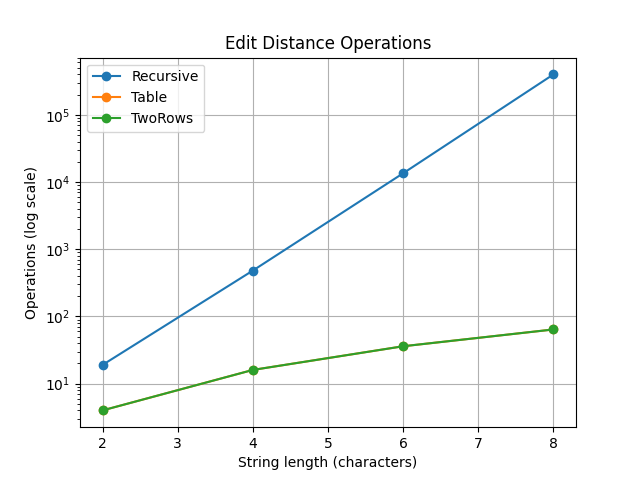
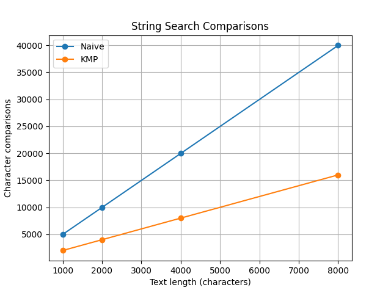
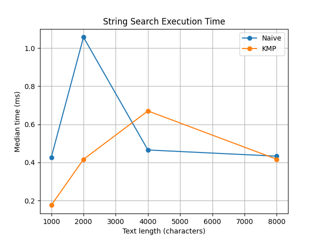

# Assignment 4 — Dynamic Programming and String Algorithms

## Otegen Talshyn SE-2525

## 1. Experiment Design Card

| Field | Description |
|---|---|
| Question | How does the performance of Edit Distance and String Search algorithms change when input size increases? |
| Sizes | Edit Distance: 2, 4, 6, 8. String Search: 1000, 2000, 4000, 8000. |
| Inputs | Edit Distance: random and different strings. String Search: random and worst-case strings. |
| Metrics | Execution time in milliseconds, recursive calls, DP cell updates, and character comparisons. |
| Prediction | Recursive Edit Distance will be much slower. DP versions will be faster. KMP will use fewer comparisons than Naive Search on difficult inputs. |
| Plots | Edit Distance operations, String Search comparisons, and String Search execution time. |

## 2. Algorithms

I implemented five algorithms in Java.

- Recursive Edit Distance uses recursion without storing previous results.
- Table Edit Distance uses a two-dimensional DP table.
- Two Rows Edit Distance uses only two arrays to save memory.
- Naive Search compares the pattern at every possible position.
- KMP Search uses the LPS array to avoid unnecessary comparisons.

## 3. Experiment Results

Each algorithm was tested with four input sizes and two input types. Each experiment was repeated three times.

The results were saved in `results/results.csv`. The median execution time was used for the graphs.

### Plot 1 — Edit Distance Operations

The recursive algorithm requires many more operations as the string length increases. Both DP versions use the same number of cell updates.

### Plot 2 — String Search Comparisons

KMP performs fewer character comparisons than Naive Search on the difficult input.

### Plot 3 — String Search Execution Time

Execution time changes between runs. KMP is not always faster in milliseconds, even when it performs fewer comparisons.

## 4. Prediction vs Results

### Edit Distance

I expected the recursive algorithm to be the slowest because it repeats the same calculations. The results supported this prediction. For strings of length 8 in the different-input case, recursion made 398593 calls, while each DP version updated only 64 cells.

### String Search

I expected KMP to perform fewer comparisons on difficult inputs. The results supported this prediction. For a text length of 8000, Naive Search performed 39980 comparisons, while KMP performed 16003 comparisons.

## 5. Short Answers

### Which input made string search slowest, and why?

The difficult input used a text containing repeated `a` characters and the pattern `aaaab`. Naive Search repeatedly matched several characters before finding a mismatch. This increased the number of comparisons. KMP avoided repeating many of these comparisons by using the LPS array.

### How large an n could recursive Edit Distance handle?

I tested recursive Edit Distance up to n = 8. It worked, but the number of recursive calls increased very quickly. At n = 8, it made 398593 calls on the different-input case. Larger inputs would require much more time because the algorithm repeats calculations.

### What do you gain and lose with two rows?

The Two Rows version uses less memory than the full DP table. It stores only the previous and current rows. Both versions have O(n × m) time complexity. However, the Two Rows version does not keep the full table, which makes reconstructing the sequence of edits more difficult.

### Which string search would you choose for the city platform?

I would choose KMP for searching large text files. It uses the LPS array and avoids unnecessary comparisons. Its worst-case time complexity is O(n + m). This makes it useful for searching patterns in long logs.

## 6. Execution Time

I measured execution time using `System.nanoTime()` in Java. Each experiment was repeated three times, and I used the median for comparison. Some measurements changed because of JVM warm-up and other computer processes. Therefore, I also measured operations and character comparisons to understand the performance.

## 7. Conclusion

In this assignment, I implemented and compared three Edit Distance algorithms and two String Search algorithms. Dynamic programming significantly reduced repeated work compared with recursion. KMP performed fewer comparisons than Naive Search on difficult inputs. I learned how to measure algorithms using execution time and operation counters.